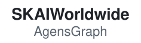

<p align="center">
  <picture>
    <source media="(prefers-color-scheme: dark)" srcset="images/agensgraph-logo-dark.svg">
    
  </picture>
</p>

<p align="center">
  <b>A high-performance graph database built on PostgreSQL.</b><br>
  Graphs and tables in one database. SQL, openCypher and ISO GQL in one query.
</p>

<p align="center">
  <a href="https://tech.skaiworldwide.com/docs/en/agensgraph/18/">Documentation</a> ·
  <a href="#quick-start">Quick start</a> ·
  <a href="#ai-and-agents">AI and agents</a> ·
  <a href="https://github.com/skaiworldwide-oss/agensgraph/discussions">Discussions</a> ·
  <a href="https://github.com/skaiworldwide-oss/agensgraph/releases">Releases</a>
</p>

<p align="center">
  <a href="https://github.com/skaiworldwide-oss/agensgraph/actions/workflows/regression.yml"></a>
  <a href="https://github.com/skaiworldwide-oss/agensgraph/releases/latest"></a>
  <a href="https://hub.docker.com/r/skaiworldwide/agensgraph"></a>
  <a href="LICENSE"></a>
</p>

## What AgensGraph is

- PostgreSQL with the property graph model built in. A fork of PostgreSQL, not an extension.
- A graph is a schema, a label is a table, a vertex or an edge is a row.
- Graph data and relational tables live in one database and commit in one transaction.
- Query with SQL, openCypher and ISO GQL (ISO/IEC 39075). Mix them in one statement.
- Everything PostgreSQL has works on graph data: transactions, roles, row-level security, replication, `pg_dump`, `EXPLAIN`, extensions such as `pgvector`.
- Apache License 2.0.

## Quick start

**1. Start a server**

```shell
docker run --name agensgraph -e POSTGRES_PASSWORD=agensgraph -d skaiworldwide/agensgraph:v2.18.6.1-bookworm
docker exec -it agensgraph agens -U agens -d postgres
```

**2. Create a graph**

```sql
CREATE GRAPH movies;
SET graph_path = movies;

CREATE (keanu:person {name: 'Keanu Reeves'}),
       (carrie:person {name: 'Carrie-Anne Moss'}),
       (matrix:movie {title: 'The Matrix', year: 1999}),
       (wick:movie {title: 'John Wick', year: 2014}),
       (keanu)-[:acted_in {role: 'Neo'}]->(matrix),
       (carrie)-[:acted_in {role: 'Trinity'}]->(matrix),
       (keanu)-[:acted_in {role: 'John Wick'}]->(wick);
```

**3. Match a pattern**

```sql
MATCH (:person {name: 'Carrie-Anne Moss'})-[:acted_in]->(m:movie)<-[:acted_in]-(co:person)
RETURN co.name AS co_star, m.title AS movie;
```

```
    co_star     |    movie
----------------+--------------
 "Keanu Reeves" | "The Matrix"
(1 row)
```

**4. Follow a path of any length**

```sql
MATCH (:person {name: 'Carrie-Anne Moss'})-[:acted_in*1..3]-(m:movie)
RETURN DISTINCT m.title AS reachable ORDER BY reachable;
```

```
  reachable
--------------
 "John Wick"
 "The Matrix"
(2 rows)
```

**5. Join the graph to a table**

```sql
CREATE TABLE my_ratings (title text, stars int);
INSERT INTO my_ratings VALUES ('The Matrix', 5), ('John Wick', 4);

SELECT f.title, r.stars
FROM (MATCH (:person {name: 'Keanu Reeves'})-[:acted_in]->(m:movie)
      RETURN m.title AS title) AS f
JOIN my_ratings r ON r.title = f.title #>> '{}'
ORDER BY r.stars DESC;
```

```
    title     | stars
--------------+-------
 "The Matrix" |     5
 "John Wick"  |     4
(2 rows)
```

Next: [the example dataset](https://tech.skaiworldwide.com/docs/en/agensgraph/18/get_started/example-dataset.html) ·
[combining SQL and Cypher](https://tech.skaiworldwide.com/docs/en/agensgraph/18/querying/combining-sql-and-cypher.html) ·
[paths](https://tech.skaiworldwide.com/docs/en/agensgraph/18/querying/paths.html)

## Query languages

| Language | Use it for | Docs |
|---|---|---|
| SQL | Tables, DDL, administration, and queries over a Cypher subquery | [Combining SQL and Cypher](https://tech.skaiworldwide.com/docs/en/agensgraph/18/querying/combining-sql-and-cypher.html) |
| openCypher | Patterns, paths, graph writes | [Reading](https://tech.skaiworldwide.com/docs/en/agensgraph/18/querying/reading.html), [Writing](https://tech.skaiworldwide.com/docs/en/agensgraph/18/querying/writing.html) |
| ISO GQL | `LET`, `FILTER`, `FOR`, `NEXT`, `FINISH`, `INSERT`, `CALL { }`, subquery expressions | [GQL conformance](https://tech.skaiworldwide.com/docs/en/agensgraph/18/appendix/gql-conformance.html) |

GQL and Cypher are one language. No mode switch:

```sql
MATCH (p:person)-[:acted_in]->(m:movie)
RETURN p.name AS actor, count(m) AS movies
NEXT FILTER movies > 1
RETURN actor;
```

```
     actor
----------------
 "Keanu Reeves"
(1 row)
```

## Features

| Area | What you get |
|---|---|
| Graph model | Vertex and edge labels, label inheritance, property indexes, constraints |
| Paths | Variable-length patterns, `shortestpath()`, `allshortestpaths()`, `dijkstra()` |
| Subqueries | `CALL { }`, `OPTIONAL CALL`, `EXISTS { }`, `COUNT { }`, `COLLECT { }`, `VALUE { }` |
| Typed columns | Store chosen properties in typed, indexable columns ([typed columns](https://tech.skaiworldwide.com/docs/en/agensgraph/18/querying/typed-columns.html)) |
| Search | Vector and full-text search on properties through PostgreSQL extensions ([vector](https://tech.skaiworldwide.com/docs/en/agensgraph/18/guides/search/vector.html), [full text](https://tech.skaiworldwide.com/docs/en/agensgraph/18/guides/search/full-text.html)) |
| Planner | Row estimates for paths, label pruning, skipped scans for unused endpoints |
| Security | Grants and row-level security on labels, enforced for Cypher reads and writes |
| Operations | `pg_dump` / `pg_restore`, `pg_upgrade`, streaming and logical replication |


## AI and agents

- Knowledge graph, embeddings (with `pgvector`) and agent memory in one PostgreSQL database.
- GraphRAG in one statement: vector, full-text or hybrid search, then a graph traversal.
- MCP servers give AI assistants and agents tool access to the graph.

| Integration | What it provides | Package |
|---|---|---|
| MCP: Cypher | Schema introspection and read/write Cypher tools for MCP clients such as Claude Desktop | [`mcp-agensgraph-cypher`](https://pypi.org/project/mcp-agensgraph-cypher/) |
| MCP: Memory | Knowledge-graph memory for agents: entities, relations, observations | [`mcp-agensgraph-memory`](https://pypi.org/project/mcp-agensgraph-memory/) |
| MCP: Data modeling | Graph model validation; generated ingest and constraint Cypher | [`mcp-agensgraph-data-modeling`](https://pypi.org/project/mcp-agensgraph-data-modeling/) |
| LangChain | Graph store, pgvector vector store, chat history, LangGraph checkpointer, LLM graph transformer | [`langchain-agensgraph`](https://pypi.org/project/langchain-agensgraph/) |
| LlamaIndex | `PropertyGraphIndex` and `VectorStoreIndex` stores, hybrid search, Text2Cypher | [`llama-index-agensgraph`](https://pypi.org/project/llama-index-agensgraph/) |
| LightRAG | All four LightRAG storage roles in one database, with workspace multi-tenancy | [`lightrag-agensgraph`](https://pypi.org/project/lightrag-agensgraph/) |
| cognee | Graph and vector adapters for the cognee AI-memory framework | [`cognee-agensgraph`](https://pypi.org/project/cognee-agensgraph/) |

```shell
pip install "agensgraph-ai[all]"     # or one of: [mcp] [langchain] [llama-index] [lightrag] [cognee]
```

[AgensGraph AI documentation](https://tech.skaiworldwide.com/docs/en/agensgraph-ai/) ·
[source and demos](https://github.com/skaiworldwide-oss/agensgraph-ai) ·
[GraphRAG without a framework](https://tech.skaiworldwide.com/docs/en/agensgraph/18/guides/search/hybrid.html)

## Install

| Route | How |
|---|---|
| Docker | `skaiworldwide/agensgraph:v<release>-<base>`. Bases: `bookworm`, `trixie`, `alpine3.23`, `alpine3.24`, `rocky9`, `rocky10` ([Docker Hub](https://hub.docker.com/r/skaiworldwide/agensgraph)) |
| Source | [Build from source](https://tech.skaiworldwide.com/docs/en/agensgraph/18/get_started/install.html) |
| Upgrade from 2.17 | [Upgrading to 2.18](https://tech.skaiworldwide.com/docs/en/agensgraph/18/release_notes/upgrade-to-2.18.html) |

## Drivers

Any PostgreSQL driver connects ([drivers and client libraries](https://tech.skaiworldwide.com/docs/en/agensgraph/18/drivers/index.html)). The Python driver adds graph types:

| Language | Package | Docs | Repository |
|---|---|---|---|
| Python | [`agensgraph-python`](https://pypi.org/project/agensgraph-python/) | [AgensGraph for Python](https://tech.skaiworldwide.com/docs/en/agensgraph-driver/python/) | [agensgraph-python](https://github.com/skaiworldwide-oss/agensgraph-python) |

## Documentation

- [Manual](https://tech.skaiworldwide.com/docs/en/agensgraph/18/)
- [Tuning queries](https://tech.skaiworldwide.com/docs/en/agensgraph/18/querying/performance.html)
- [Configuration](https://tech.skaiworldwide.com/docs/en/agensgraph/18/operations/configuration.html)
- [Release notes](https://tech.skaiworldwide.com/docs/en/agensgraph/18/release_notes/2.18.html) and [downloads](https://github.com/skaiworldwide-oss/agensgraph/releases)
- In-tree reference: `doc/src/sgml/agensgraph.sgml` and `doc/src/sgml/ref/cypher_*.sgml`


## Community

- Questions: [Discussions](https://github.com/skaiworldwide-oss/agensgraph/discussions)
- Bugs and feature requests: [Issues](https://github.com/skaiworldwide-oss/agensgraph/issues)
- Code: pull requests against `main`

## License

- AgensGraph: [Apache License 2.0](LICENSE). See [NOTICE](NOTICE).
- Portions from PostgreSQL: PostgreSQL License. See [COPYRIGHT](COPYRIGHT).
